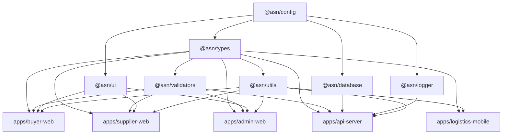

# Monorepo Structure & Package Boundaries

The ASN monorepo is organized with **pnpm workspaces** and **Turborepo** to maximize code reuse, ensure single-source-of-truth validation, and accelerate build pipelines.

---

## 1. Directory Tree & Responsibilities

```
apps/
├── api-server/         # NestJS backend application
├── buyer-web/          # Next.js 14 App: Buyer Marketplace & Vehicle Garage
├── supplier-web/       # Next.js 14 App: Supplier OS & Supply Network Desk
├── admin-web/          # Next.js 14 App: Admin Operations Console
└── logistics-mobile/   # React Native / Expo: Driver & Courier App

packages/
├── config/             # Base configurations for TypeScript, ESLint, Prettier
├── database/           # Prisma schema, migrations, seeders & client singleton
├── logger/             # Structured JSON logging with traceId correlation
├── types/              # Domain models, enums and API contracts
├── ui/                 # Tailwind CSS design system and reusable UI components
├── utils/              # Automotive helpers, INR currency formatters, Haversine geo formulas
└── validators/         # Zod validation schemas shared between client and server
```

---

## 2. Dependency Graph & Rules



### Boundary Enforcements

1. **No Circular Dependencies:** Turborepo enforces a strict DAG (Directed Acyclic Graph). Shared packages must never depend on `apps/`.
2. **Single Source of Validation Truth:** Validation rules live strictly inside `@asn/validators`. Frontend forms consume them via `react-hook-form` resolvers, and backend controllers consume them via validation pipes.
3. **Database Client Ownership:** Only `@asn/database` directly interfaces with Prisma. Apps and packages consume the exported `prisma` client.
