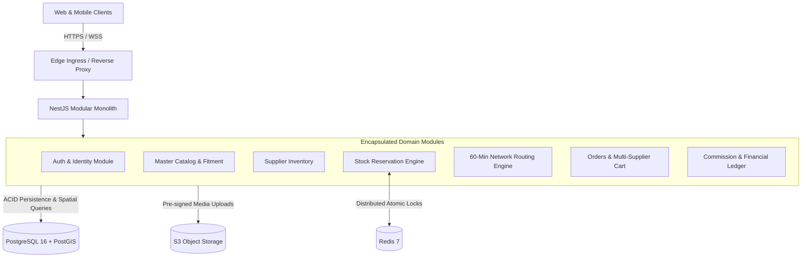

# ASN System Architecture

## 1. Architectural Style: Modular Monolith

The Automotive Supply Network (ASN) backend is built as a **Modular Monolith** using **NestJS**.

### Why Not Microservices for MVP?

1. **Transaction Integrity:** Multi-supplier checkouts, 5-minute atomic stock reservations, and payment allocations require ACID transactions across tables. Distributed sagas or 2PC (Two-Phase Commit) would introduce latency and failure modes.
2. **Network Latency:** Meeting the **60-Minute Delivery Promise** requires sub-100ms internal processing for proximity searches and multi-leg route calculations. Internal in-memory method calls and event bus emissions are orders of magnitude faster than inter-service HTTP/gRPC roundtrips.
3. **Operational Simplicity:** Single deployment pipeline, shared database connection pooling, unified monitoring, and streamlined local development.

---

## 2. Data Flow & Boundary Isolation

### Module Encapsulation Rules

- **No Cross-Module Database Joins:** Modules access other module tables strictly through domain service interfaces.
- **Asynchronous Coupling via Domain Events:** Cross-cutting side effects (e.g., sending WhatsApp notifications after an order is confirmed, or logging commission ledger lines) are decoupled using NestJS `EventEmitter2`.

---

## 3. Data Tier Responsibilities

- **PostgreSQL 16 (Single Source of Truth):**
  - All financial ledger entries (immutable, append-only).
  - Master vehicle and part catalog.
  - Order states and supplier profiles.
  - PostGIS spatial data (`ST_DWithin`) for calculating local supplier density around garages.
- **Redis 7 (Distributed Coordination & Cache):**
  - 5-minute atomic reservation locks (`SET NX PX`).
  - BullMQ job queues for delayed reservation expiration.
  - User session tokens and invalidated token blacklists.
