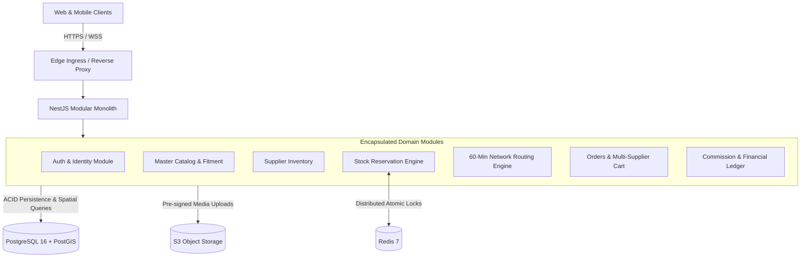

# ASN System Architecture

## 1. Architectural Style: Modular Monolith

The Automotive Supply Network (ASN) backend is built as a **Modular Monolith** using **NestJS**.

### Why Not Microservices for MVP?

1. **Transaction Integrity:** Multi-supplier checkouts, 5-minute atomic stock reservations, and payment allocations require ACID transactions across tables. Distributed sagas or 2PC (Two-Phase Commit) would introduce latency and failure modes.
2. **Network Latency:** Meeting the **60-Minute Delivery Promise** requires sub-100ms internal processing for proximity searches and multi-leg route calculations. Internal in-memory method calls and event bus emissions are orders of magnitude faster than inter-service HTTP/gRPC roundtrips.
3. **Operational Simplicity:** Single deployment pipeline, shared database connection pooling, unified monitoring, and streamlined local development.

---

## 2. Data Flow & Boundary Isolation



### Module Encapsulation Rules

- **No Cross-Module Database Joins:** Modules access other module tables strictly through domain service interfaces.
- **Asynchronous Coupling via Domain Events:** Cross-cutting side effects (e.g., sending WhatsApp notifications after an order is confirmed, or logging commission ledger lines) are decoupled using NestJS `EventEmitter2`.

---

## 3. Data Tier Responsibilities

- **PostgreSQL 16 (Single Source of Truth):**
  - All financial ledger entries (immutable, append-only).
  - Master vehicle and part catalog.
  - Order states and supplier profiles.
  - PostGIS spatial data (`ST_DWithin`) for calculating local supplier density around garages.
- **Redis 7 (Distributed Coordination & Cache):**
  - 5-minute atomic reservation locks (`SET NX PX`).
  - BullMQ job queues for delayed reservation expiration.
  - User session tokens and invalidated token blacklists.

---

## 4. Multi-Tenant Identity, Authentication & Session Security

### 4.1 Phone-Based OTP Authentication

- **Indian Mobile Normalization:** Accepts `+91`, `0`, or 10-digit formats and normalizes to standard 10-digit format.
- **Security Controls:**
  - Rate-limited to max 5 requests per 15-minute sliding window with a mandatory 60-second cooldown between requests.
  - Maximum 5 failed verification attempts before permanent OTP invalidation.
  - OTPs stored exclusively as salted SHA-256 hashes (`otp_hash`).
  - Cryptographically secure timing-safe hash comparison (`crypto.timingSafeEqual`).
  - Single-use guarantee (`is_used: true`).
  - Uniform response messages to prevent phone number enumeration.
  - Zero OTP logging in production.

### 4.2 JWT Session Security & Refresh Token Rotation

- **Access Tokens:** Short-lived (15 minutes), containing user ID, phone, role, and active business context.
- **Refresh Tokens:** Long-lived (7 days), stored as SHA-256 hashes in `refresh_sessions`.
- **Automatic Reuse Detection:** Refresh tokens are bound to a cryptographic `familyId`. If an already-rotated or revoked token is replayed by an adversary, the entire token family is immediately invalidated, terminating all sessions for that device.
- **Dual Client Support:** Supports HttpOnly, Secure, `SameSite=Lax` cookies for browser clients, with simultaneous support for Authorization Bearer tokens in mobile requests.

### 4.3 Multi-Tenant RBAC & Tenant Isolation

- Users can belong to multiple businesses (`BusinessMember`).
- `TenantContextGuard` intercepts incoming requests, reads the `X-Business-Id` header, and verifies active membership in PostgreSQL.
- `RolesGuard` evaluates `@RequireRoles(UserRole.BUSINESS_OWNER, UserRole.BUSINESS_ADMIN)`.
- Platform Super Admins have universal read/write bypass for cross-tenant governance and emergency intervention.
- Sensitive actions (`USER_LOGIN_OTP`, `BUSINESS_CREATED`, `BUSINESS_CONTEXT_SWITCHED`, `BUSINESS_MEMBER_INVITED`) write immutable records to `audit_logs`.

---

## 5. Automotive Product Catalog & Vehicle Fitment Architecture

### 5.1 Decoupled Master Catalog vs. Supplier Inventory

- **`MasterProduct`**: Canonical representation of automotive aftermarket parts. Stores universal specifications, dimensions, brand, category, safety-critical indicators, media, and vehicle compatibility.
- **`SupplierProduct`**: Stores tenant-specific inventory, stock levels, warehouse locations, and pricing. Decoupled from `MasterProduct` to preserve catalog data integrity across multi-seller listings.
- **Access Boundaries**: Buyer searches query `MasterProduct` with status `ACTIVE`. Catalog mutation endpoints (`POST /api/v1/catalog/products`) require `BUSINESS_OWNER`, `BUSINESS_ADMIN`, `SUPPLIER_ADMIN`, or `CATALOG_SPECIALIST` privileges.

### 5.2 Punctuation-Insensitive Search & Normalized Part Numbers

- Indian automotive mechanics and suppliers query part numbers using unpredictable spacing and punctuation (e.g. `0 986 AB1 234`, `0986-AB1-234`, `0986AB1234`).
- All parts and OEM numbers maintain indexed normalized columns (`normalized_part_number`, `normalized_oem_number`) stripping spaces, dashes, dots, and underscores.
- Queries execute index scans across both original and normalized values, brand names, and linked OEM cross references (`oem_part_references`).

### 5.3 Hierarchical Category Engine

- Two-tier or multi-tier category structures managed through self-referential adjacency (`parent_id`).
- Unique slug indexing (`product_categories.slug`) allows querying top-level domains (e.g. `brake-system`) which automatically resolves child categories (e.g. `brake-pads`, `brake-discs-rotors`).

### 5.4 Vehicle Fitment & Compatibility Engine

- Structured three-tier vehicle hierarchy: `VehicleMake` -> `VehicleModel` -> `VehicleVariant`.
- `VehicleVariant` defines production year range (`start_year`, `end_year`), `fuel_type`, `engine_capacity`, and `transmission`.
- `ProductFitment` maps products to variants with optional component-level installation positions (`Front Axle`, `Rear`) and custom fitment year overrides (`fitment_start_year`, `fitment_end_year`).
- Compatibility verification ensures:
  1. The queried vehicle model year falls within the variant's manufacturing span.
  2. The queried year satisfies any component-specific fitment year overrides.
  3. The mapped fitment is verified (`is_verified = true`) and the product is active.

---

## 6. Supplier OS, Multi-Warehouse Inventory & Bulk Import Engine

### 6.1 Multi-Warehouse Management & Tenant Isolation

- **`SupplierWarehouse`**: Models physical warehouse facilities operated by a supplier business.
- Each warehouse is uniquely identified by `code` within the tenant scope (`[business_id, code]`).
- Supports primary warehouse designation (`is_primary`), geospatial coordinates (`latitude`, `longitude`), and contact metadata.
- All warehouse and inventory endpoints enforce strict tenant isolation via `TenantContextGuard` and `X-Business-Id`.

### 6.2 Real-Time Stock Control & Non-Negative Guarantees

- **`WarehouseInventory`**: Tracks warehouse-level stock partitions:
  - `quantity`: Total physical inventory on hand.
  - `availableQuantity`: Stock free to promise to buyers (`quantity - reservedQuantity - damagedQuantity`).
  - `reservedQuantity`: Stock held in active cart reservations or pending dispatch.
  - `damagedQuantity`: Stock quarantined due to transit or warehouse damage.
- **Atomic Concurrency Protection**:
  - All stock adjustments execute inside transactional blocks (`prisma.$transaction`).
  - Negative stock is strictly rejected: adjustments that would cause `quantity < 0` or `availableQuantity < 0` abort with `400 Bad Request`.
  - Dynamically recalculates `SupplierProduct.availableQuantity` as the aggregate sum across all active warehouses.
  - Automatically updates `stockStatus` to `OUT_OF_STOCK`, `LOW_STOCK`, or `IN_STOCK`.

### 6.3 Auditable Inventory Movement Ledger

- **`InventoryMovement`**: Every physical adjustment, restock, sale, correction, or import writes an immutable ledger entry.
- Records `previous_balance`, `new_balance`, signed `change_quantity`, `reason`, `notes`, `user_id`, and `reference_id` (e.g. order ID, PO number, or import job ID).

### 6.4 Staged Bulk CSV/Excel Import Pipeline

- **Four-Stage Ingestion Pipeline**:
  1. **Upload & Parse**: Accepts CSV content, detects delimiter (comma, semicolon, tab), and normalizes column headers.
  2. **Intra-File Validation**: Detects duplicate SKUs or duplicate part/brand combinations within the uploaded spreadsheet.
  3. **Master Catalog Matching**: Looks up each part number against indexed normalized part numbers in `MasterProduct`. Missing parts are flagged with row numbers.
  4. **Preview & Execution**: Staged in `InventoryImportJob` with status `PREVIEW_READY`. Suppliers review error reports before committing. Executing valid rows commits inventory in atomic batches and logs `BULK_IMPORT` movements, returning `COMPLETED` or `PARTIAL_SUCCESS`.

---

## 7. Supplier Supply Network (SSN) & B2B RFQ Engine

### 7.1 Supplier-to-Supplier Wholesale Sourcing Architecture

- **`SourcingRfq`**: Enables verified automotive suppliers, workshops, and fleet operators to create wholesale procurement requests for canonical parts from `MasterProduct`.
- **Supplier Discovery**: Buyers discover verified distributors, wholesalers, and manufacturers stocking requested parts via `discoverEligibleSuppliers`, which checks active `SupplierProduct` listings and multi-warehouse physical stock balances.
- **Access & Invitation Controls**:
  - **Public Network RFQs**: Visible to all verified suppliers on the platform network.
  - **Invited RFQs**: Restricted to a targeted list of vetted suppliers via `RfqInvitedSupplier`.

### 7.2 B2B RFQ Lifecycle & State Machine

The RFQ engine manages complete status transitions:

- `DRAFT`: RFQ created and editable by buyer; not yet visible on network.
- `PUBLISHED`: Open for supplier discovery and bidding.
- `RESPONSES_RECEIVED`: At least one quotation has been submitted by an eligible supplier.
- `UNDER_NEGOTIATION`: Quotation revisions or price discussions in progress.
- `AWARDED`: Winning quotation accepted via atomic transaction.
- `CANCELLED`: Withdrawn by buyer prior to award.
- `REJECTED`: Explicitly rejected by buyer.
- `EXPIRED`: Validity period elapsed without award.

### 7.3 Strict Quotation Confidentiality & Revision Snapshots

- **Commercial Confidentiality Invariant**: Competing suppliers are strictly prohibited from viewing each other's quotes, lead times, or margins. Only the RFQ creator (buyer) and the respective responding supplier have access to quotation records.
- **Revision Snapshotting (`QuotationRevision`)**:
  When a supplier updates an offer prior to award:
  1. Current values (`unitPrice`, `totalAmount`, `leadTimeDays`, `validityUntil`, `notes`) are preserved in an immutable `QuotationRevision` record.
  2. The active `SourcingQuotation` record updates with revised pricing, delivery timeline, and an incremented `revision` number.
  3. Status updates to `REVISED`.

### 7.4 Atomic RFQ Award & Race Condition Protection

Awarding an RFQ is guarded inside a database transaction (`prisma.$transaction`):

1. Verifies RFQ status is open (`PUBLISHED`, `RESPONSES_RECEIVED`, or `UNDER_NEGOTIATION`) and `awardedQuotationId` is null.
2. Verifies the winning quotation belongs to this RFQ, is `SUBMITTED` or `REVISED`, and has not expired.
3. Updates the winning quotation status to `ACCEPTED`.
4. Atomically updates all other active quotations for this RFQ to `REJECTED`.
5. Updates RFQ status to `AWARDED` with `awardedQuotationId: quotationId`.
6. Concurrent or duplicate award attempts are rejected with `409 Conflict`.
7. Immutable audit logs are written for both buyer and winning supplier via `AuditService`.

### 7.5 Quotation Comparison Matrix & Commercial Analytics

- **Buyer Comparison Matrix (`compareQuotations`)**:
  - Aggregates all submitted quotations for an RFQ.
  - Identifies `lowestUnitPrice` and `fastestLeadTimeDays`.
  - Calculates percentage delta against the buyer's optional `targetPrice`.
  - Marks `isBestPrice` and `isFastestDelivery` badges to accelerate buyer decision-making.

---

## 8. Logistics Engine & Multi-Leg Delivery Orchestration

### 8.1 Shipment Domain & Multi-Leg Model

The logistics engine coordinates automotive parts movements across local workshops, regional supplier warehouses, and transit hubs:

- **`Shipment`**: Represents an operational freight package linked to commercial transactions (`sourcingRfqId`, `sourcingQuotationId`). Tracks sender and receiver businesses, origin warehouse, pickup/delivery addresses, delivery attempt counters, and estimated/actual delivery timestamps.
- **`ShipmentLeg`**: Models sequential transport segments (`sequenceNumber`):
  - `FIRST_MILE_PICKUP`: Warehouse dispatch and pickup consolidation.
  - `MID_MILE_TRANSFER`: Intercity line-haul freight transfer.
  - `HUB_SORTING`: Cross-docking and regional sortation.
  - `LAST_MILE_DELIVERY`: Hyper-local direct delivery to workshop or buyer.
  - If no legs are explicitly supplied during creation, a direct `LAST_MILE_DELIVERY` leg is automatically created.
- **`LogisticsProvider`**: Registry of logistics partners categorized by `LogisticsProviderType`:
  - `INTERNAL_FLEET`: ASN-managed rider and van fleet.
  - `THIRD_PARTY_3PL`: Integrated national logistics carriers (e.g. Delhivery, BlueDart).
  - `HYPERLOCAL`: On-demand intra-city courier networks.
  - `INTERCITY_FREIGHT`: Heavy freight and pallet line-haul operators.

### 8.2 Shipment Lifecycle State Machine

The system enforces an 11-stage shipment state machine:

```
DRAFT ──► CREATED ──► PICKUP_SCHEDULED ──► PICKED_UP ──► IN_TRANSIT ──► OUT_FOR_DELIVERY ──► [POD] ──► DELIVERED
   │          │                                                               │
   │          │                                                               ├──► DELIVERY_FAILED ──► RETURN_INITIATED ──► RETURNED
   ▼          ▼                                                               │
CANCELLED ◄───┴───────────────────────────────────────────────────────────────┘ (Only prior to dispatch)
```

- **Dispatch Invariant**: Shipments in `PICKED_UP`, `IN_TRANSIT`, `OUT_FOR_DELIVERY`, `DELIVERED`, or `RETURNED` cannot be cancelled.
- **Terminal States**: `DELIVERED`, `CANCELLED`, and `RETURNED` are terminal.
- **Delivery Guard**: Transition to `DELIVERED` cannot be invoked via the generic status transition endpoint; it requires explicit Proof of Delivery verification.

### 8.3 Proof of Delivery (POD) & Reverse Logistics

- **Atomic POD Submission**:
  - Requires `recipientName`, with optional `recipientPhone`, `documentUrl` (signed slip, photo, or invoice), and `verificationCode` (OTP).
  - Executed inside a database transaction: records `ProofOfDelivery`, marks `Shipment.status = DELIVERED`, completes all shipment legs, appends `DELIVERY_COMPLETED` tracking event, and writes an immutable audit record.
  - Prevents duplicate delivery submissions with `409 Conflict`.
- **Delivery Failure & Returns**:
  - `recordFailedDelivery` increments the failure attempt counter (`attemptsCount`) and records operational failure reasons.
  - When retry threshold (`maxDeliveryAttempts`) is reached or `initiateReturn: true`, the shipment transitions to `RETURN_INITIATED`.
  - Once returned to the supplier facility, the shipment transitions to `RETURNED`.

### 8.4 Tracking Ledger & Multi-Tenant Boundaries

- **`ShipmentTrackingEvent`**: Append-only event ledger capturing every state change, carrier tracking update, checkpoint scan, and delivery attempt with geographical coordinates and human-readable descriptions.
- **Tenant Isolation**: Shipments are strictly scoped to `senderBusinessId`, `receiverBusinessId`, or an assigned `LogisticsProvider`. Unauthorized businesses attempting access receive `403 Forbidden`.
