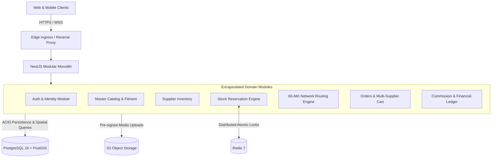

# ASN System Architecture

## 1. Architectural Style: Modular Monolith

The Automotive Supply Network (ASN) backend is built as a **Modular Monolith** using **NestJS**.

### Why Not Microservices for MVP?

1. **Transaction Integrity:** Multi-supplier checkouts, 5-minute atomic stock reservations, and payment allocations require ACID transactions across tables. Distributed sagas or 2PC (Two-Phase Commit) would introduce latency and failure modes.
2. **Network Latency:** Meeting the **60-Minute Delivery Promise** requires sub-100ms internal processing for proximity searches and multi-leg route calculations. Internal in-memory method calls and event bus emissions are orders of magnitude faster than inter-service HTTP/gRPC roundtrips.
3. **Operational Simplicity:** Single deployment pipeline, shared database connection pooling, unified monitoring, and streamlined local development.

---

## 2. Data Flow & Boundary Isolation

### Module Encapsulation Rules

- **No Cross-Module Database Joins:** Modules access other module tables strictly through domain service interfaces.
- **Asynchronous Coupling via Domain Events:** Cross-cutting side effects (e.g., sending WhatsApp notifications after an order is confirmed, or logging commission ledger lines) are decoupled using NestJS `EventEmitter2`.

---

## 3. Data Tier Responsibilities

- **PostgreSQL 16 (Single Source of Truth):**
  - All financial ledger entries (immutable, append-only).
  - Master vehicle and part catalog.
  - Order states and supplier profiles.
  - PostGIS spatial data (`ST_DWithin`) for calculating local supplier density around garages.
- **Redis 7 (Distributed Coordination & Cache):**
  - 5-minute atomic reservation locks (`SET NX PX`).
  - BullMQ job queues for delayed reservation expiration.
  - User session tokens and invalidated token blacklists.

---

## 4. Multi-Tenant Identity, Authentication & Session Security

### 4.1 Phone-Based OTP Authentication

- **Indian Mobile Normalization:** Accepts `+91`, `0`, or 10-digit formats and normalizes to standard 10-digit format.
- **Security Controls:**
  - Rate-limited to max 5 requests per 15-minute sliding window with a mandatory 60-second cooldown between requests.
  - Maximum 5 failed verification attempts before permanent OTP invalidation.
  - OTPs stored exclusively as salted SHA-256 hashes (`otp_hash`).
  - Cryptographically secure timing-safe hash comparison (`crypto.timingSafeEqual`).
  - Single-use guarantee (`is_used: true`).
  - Uniform response messages to prevent phone number enumeration.
  - Zero OTP logging in production.

### 4.2 JWT Session Security & Refresh Token Rotation

- **Access Tokens:** Short-lived (15 minutes), containing user ID, phone, role, and active business context.
- **Refresh Tokens:** Long-lived (7 days), stored as SHA-256 hashes in `refresh_sessions`.
- **Automatic Reuse Detection:** Refresh tokens are bound to a cryptographic `familyId`. If an already-rotated or revoked token is replayed by an adversary, the entire token family is immediately invalidated, terminating all sessions for that device.
- **Dual Client Support:** Supports HttpOnly, Secure, `SameSite=Lax` cookies for browser clients, with simultaneous support for Authorization Bearer tokens in mobile requests.

### 4.3 Multi-Tenant RBAC & Tenant Isolation

- Users can belong to multiple businesses (`BusinessMember`).
- `TenantContextGuard` intercepts incoming requests, reads the `X-Business-Id` header, and verifies active membership in PostgreSQL.
- `RolesGuard` evaluates `@RequireRoles(UserRole.BUSINESS_OWNER, UserRole.BUSINESS_ADMIN)`.
- Platform Super Admins have universal read/write bypass for cross-tenant governance and emergency intervention.
- Sensitive actions (`USER_LOGIN_OTP`, `BUSINESS_CREATED`, `BUSINESS_CONTEXT_SWITCHED`, `BUSINESS_MEMBER_INVITED`) write immutable records to `audit_logs`.
