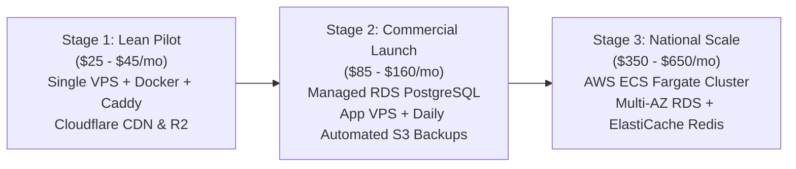

# Cost-Effective Deployment Strategy for ASN Platform

**Platform:** Automotive Supply Network (ASN)  
**Target Region:** India (Mumbai `ap-south-1` / Asia-South)  
**Target Audience:** Indian Garages, Wholesale Distributors, and Platform Admins  
**Primary Goal:** Production-grade security, high availability, sub-100ms latency, and maximum cost efficiency (starting at **₹2,100 - ₹3,800 / month** ($25 - $45/mo) with zero vendor lock-in).

---

## 1. Executive Summary & Cost Philosophy

The ASN Platform consists of:

1. **NestJS Core API Server** (Modular Monolith, Port 4000)
2. **PostgreSQL 16 + PostGIS 3.4** (ACID source of truth, spatial proximity queries)
3. **Redis 7** (Distributed locks, rate limiting, OTP cooldowns, in-memory cache)
4. **Buyer Web Portal** (Next.js 14 App Router, Port 3000)
5. **Supplier OS Portal** (Next.js 14 App Router, Port 3001)
6. **Admin Control Centre** (Next.js 14 App Router, Port 3002)

### The Startup Deployment Pitfall

Early-stage B2B platforms often deploy directly to enterprise cloud topologies (AWS EKS, Multi-AZ RDS, ElastiCache, Application Load Balancers, NAT Gateways), incurring **$450 to $800+ (₹38,000 - ₹67,000) per month** before transacting their first automotive part.

### The ASN Cost-Effective Approach

By leveraging a **modern containerized Modular Monolith**, **Caddy 2 auto-TLS reverse proxy**, and **Cloudflare edge caching with R2 object storage**, ASN can achieve enterprise-level uptime, security, and response times for **under $40/month (₹3,300/mo)** during pilot testing, scaling incrementally as commercial transaction volume grows.

---

## 2. Infrastructure Comparison Matrix

| Evaluation Dimension       | Option A: AWS Enterprise Native              | Option B: Commercial PaaS (Vercel + Railway + Supabase) | Option C: Recommended Lean Production (VPS + Docker + Cloudflare) |
| :------------------------- | :------------------------------------------- | :------------------------------------------------------ | :---------------------------------------------------------------- |
| **Compute Topology**       | AWS ECS Fargate (4 tasks) + ALB              | Vercel Pro ($20/seat) + Railway ($20)                   | Single Ubuntu 24.04 VPS (4 vCPU / 8GB RAM)                        |
| **Database**               | AWS RDS PostgreSQL Multi-AZ (`db.t4g.small`) | Supabase Pro ($25) or Neon                              | PostgreSQL 16 + PostGIS on NVMe SSD volume                        |
| **Cache & Queues**         | AWS ElastiCache Redis (`cache.t4g.micro`)    | Upstash Redis Pay-as-you-go                             | Redis 7 Alpine with AOF persistence                               |
| **Reverse Proxy / SSL**    | AWS ALB + ACM ($25/mo base)                  | Handled by PaaS                                         | Caddy v2 (Let's Encrypt auto-renewal, HTTP/3)                     |
| **Static Assets / CDN**    | CloudFront + S3 ($0.09/GB egress)            | Vercel Edge Network                                     | Cloudflare CDN (Free) + Cloudflare R2 ($0 egress)                 |
| **Estimated Monthly Cost** | **$450 – $750 / mo** (₹38k – ₹63k)           | **$85 – $160 / mo** (₹7.1k – ₹13.4k)                    | **$25 – $45 / mo** (₹2.1k – ₹3.8k)                                |
| **Vendor Lock-In**         | High (AWS specific constructs)               | Moderate (Platform APIs & proprietary limits)           | **Zero (Pure Docker / OCI containers)**                           |
| **Data Locality**          | Mumbai (`ap-south-1`)                        | Variable / Often US/EU without enterprise add-on        | **Mumbai, India (Direct local low-latency)**                      |

---

## 3. The 3-Stage Evolutionary Deployment Roadmap

### Stage 1: Lean Pilot & Beta Testing (Current Target)

- **Target Volume:** Up to 50 active workshops, 20 suppliers, 5,000 daily catalog queries.
- **Hosting Target:** Single Cloud VPS in India region:
  - **Option 1 (Recommended):** DigitalOcean Mumbai Droplet (4 vCPU / 8 GB RAM / 160 GB NVMe SSD) = **$48/mo**.
  - **Option 2 (Lowest Cost):** Hetzner Cloud (CPX31: 4 vCPU / 8 GB RAM) = **€14 (~$16/mo)** (EU/Singapore).
  - **Option 3 (AWS Ecosystem):** AWS Lightsail Mumbai (2 vCPU / 4 GB RAM / 80 GB SSD) = **$24/mo**.
- **Edge Layer:** Cloudflare Free Plan for DNS, DDoS filtering, SSL/TLS termination, and Edge caching.
- **Media Storage:** Cloudflare R2 (10 GB free storage, **zero egress fees**, S3-compatible API).
- **Zero-Cost Telemetry:** Self-hosted Uptime Kuma for heartbeat checks, GlitchTip or Sentry Free Developer tier (5,000 errors/mo) for runtime exceptions.

### Stage 2: Commercial Launch & Multi-City Expansion

- **Trigger:** > 150 active garages, real monetary payments active, > ₹20 Lakhs monthly gross merchandise value (GMV).
- **Topology:**
  - Decouple Database to **Managed PostgreSQL with PostGIS** (AWS RDS `db.t4g.small` or Aiven Mumbai: ~$45/mo) for point-in-time recovery and automated failover.
  - Dedicated Compute VPS running the NestJS API and Next.js frontends (~$40/mo).
  - Offsite automated S3 snapshot backups every 6 hours.

### Stage 3: High-Growth National Platform

- **Trigger:** > 1,000 garages across multiple states, > 10,000 daily SKU reservations.
- **Topology:**
  - AWS ECS Fargate autoscaling containers behind Application Load Balancer.
  - Multi-AZ RDS PostgreSQL 16 with Read Replicas for catalog queries.
  - ElastiCache Redis cluster for atomic stock reservation holds.

---

## 4. Domain & URL Architecture

All platform interfaces are routed under a single primary domain (e.g., `asn.in` or `asnplatform.in`) using clean, professional subdomains terminated by **Caddy 2**:

| Service                       | Public URL                               | Upstream Container               | Purpose                                                           |
| :---------------------------- | :--------------------------------------- | :------------------------------- | :---------------------------------------------------------------- |
| **Buyer Marketplace**         | `https://buyer.asn.in` (or `app.asn.in`) | `buyer-web:3000`                 | Garages & workshops placing orders, browsing catalog              |
| **Supplier Operating System** | `https://supplier.asn.in`                | `supplier-web:3001`              | Suppliers managing stock, CSV imports, quoting RFQs               |
| **Admin Control Centre**      | `https://admin.asn.in`                   | `admin-web:3002`                 | Platform Super Admins managing verification & disputes            |
| **Core API Gateway**          | `https://api.asn.in`                     | `api-server:4000`                | NestJS REST API, Swagger docs (`/docs`), health check (`/health`) |
| **Public Landing Page**       | `https://asn.in`                         | `buyer-web:3000` (or static CDN) | Marketing, supplier acquisition, platform overview                |

---

## 5. Security & Operational Hardening in Cost-Effective Mode

Cost-effective does **not** mean insecure. The following guardrails are enforced on the production host:

1. **Strict Firewall (UFW):** Only ports `80` (HTTP redirect) and `443` (HTTPS) are exposed publicly. Ports `5432` (PostgreSQL), `6379` (Redis), and internal Node ports (`3000`, `3001`, `3002`, `4000`) are bound to internal Docker bridge networks and never accessible over the public Internet.
2. **Production Safety Validation (`ALLOW_DEV_OTP=false`):** Verified by `BackendEnvSchema` at boot time to prevent development test bypasses from ever running in production.
3. **Database Volume Persistence:** PostgreSQL data is mounted to a dedicated host NVMe block storage volume (`/var/lib/docker/volumes/asn_postgres_data`), isolated from container lifecycles.
4. **Automated Disaster Recovery Backups:** A daily cron script performs `pg_dump`, encrypts the archive with GPG, and uploads it to an S3/Cloudflare R2 bucket with 30-day lifecycle retention.
5. **Zero-Downtime Container Restarts:** Containers use Docker `restart: unless-stopped` policies and health checks with automated health status polling before traffic routing.

---

## 6. Monthly Cost Estimate Breakdown (Stage 1 Pilot)

| Component                                    | Provider & Tier                             | Monthly Cost (USD)  | Monthly Cost (INR)  |
| :------------------------------------------- | :------------------------------------------ | :------------------ | :------------------ |
| **Host Compute (4 vCPU / 8 GB RAM)**         | DigitalOcean Mumbai or AWS Lightsail        | $24.00 – $48.00     | ₹2,000 – ₹4,000     |
| **DNS, CDN, DDoS & WAF**                     | Cloudflare Free Tier                        | $0.00               | ₹0                  |
| **SSL/TLS Certificates**                     | Let's Encrypt (Automated via Caddy)         | $0.00               | ₹0                  |
| **Product Media & Document Storage**         | Cloudflare R2 (First 10 GB free, $0 egress) | $0.00 – $1.00       | ₹0 – ₹85            |
| **Transactional SMS / OTP (Twilio / Msg91)** | 1,000 Indian OTPs @ ~₹0.20/SMS              | $2.50               | ₹200                |
| **Error Monitoring & Heartbeats**            | Sentry Developer Tier + Uptime Kuma         | $0.00               | ₹0                  |
| **Total Estimated Operating Cost**           |                                             | **$26.50 – $51.50** | **₹2,200 – ₹4,285** |

---

## 7. Next Steps

To deploy the ASN platform following this cost-effective strategy, refer to the accompanying operational guides:

- [Docker Compose Production Guide](file:///Users/rupeshsingh/Documents/WorkSpace/ASN-Platform/docs/deployment/docker-compose-production-guide.md)
- [Environment & Secrets Checklist](file:///Users/rupeshsingh/Documents/WorkSpace/ASN-Platform/docs/deployment/environment-and-secrets-checklist.md)
- [Step-by-Step Server Setup Runbook](file:///Users/rupeshsingh/Documents/WorkSpace/ASN-Platform/docs/deployment/step-by-step-setup-runbook.md)
